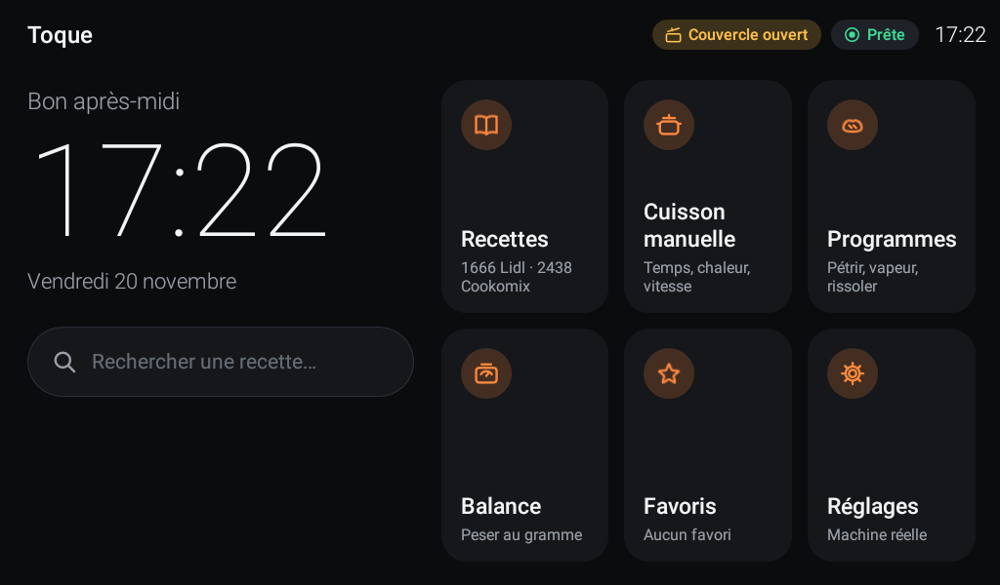
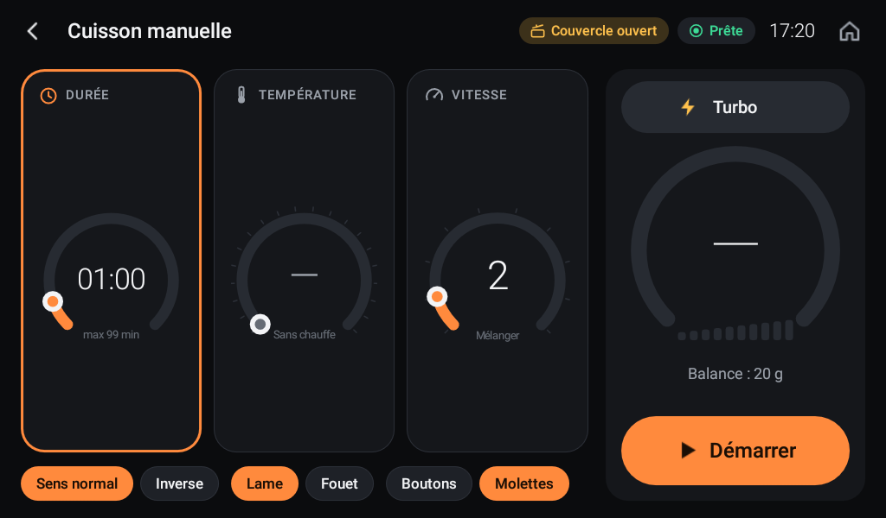
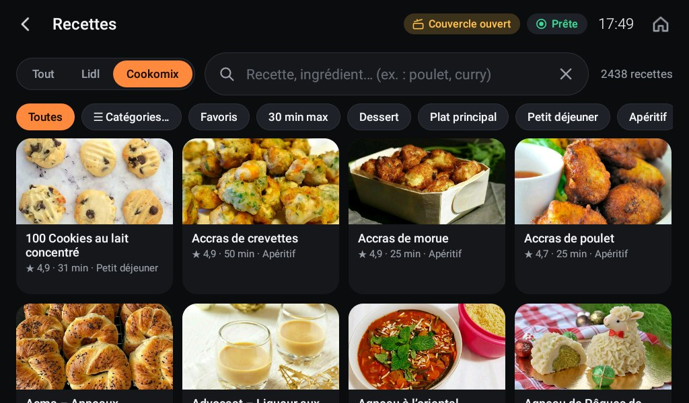
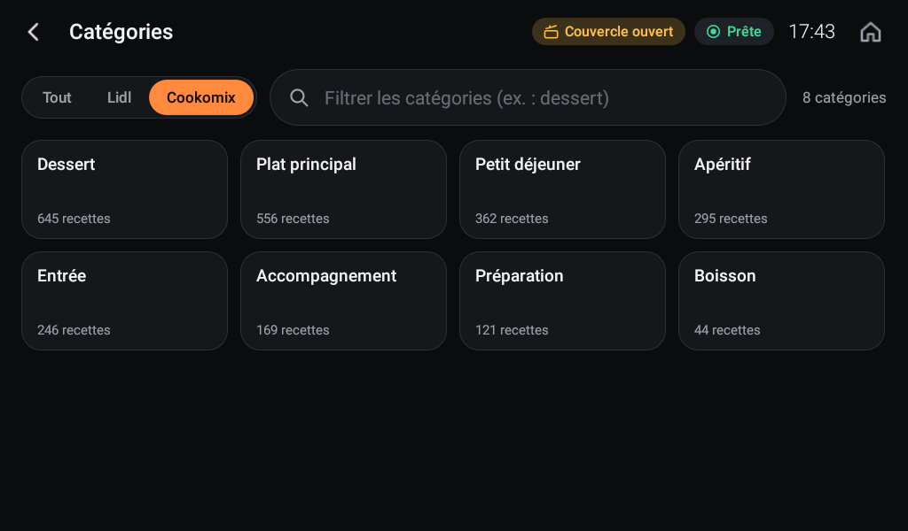
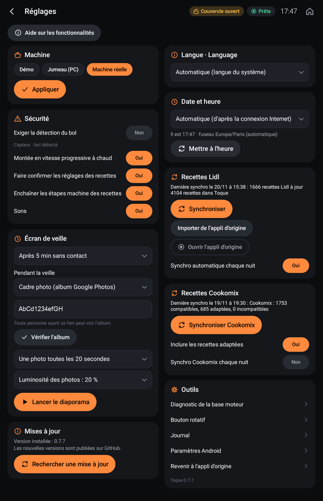
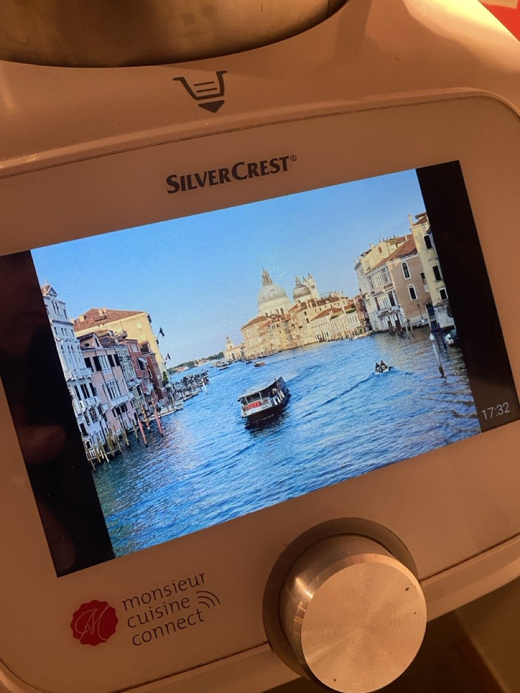
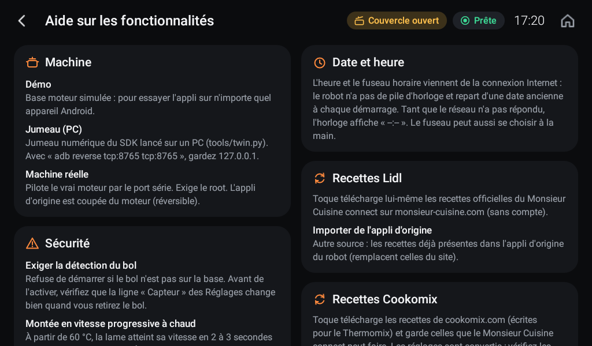

# MrCuisineConnectCookomix

> **Fork with Cookomix recipes.** A copy of
> [flexbox/MrCuisineVibeConnect](https://github.com/flexbox/MrCuisineVibeConnect) whose Toque app
> adds the [cookomix.com](https://www.cookomix.com) recipes that the Monsieur Cuisine Connect can
> make, alongside the Lidl recipes. Toque updates from **this** repository's releases (same
> signature as the original, so it installs over it).
>
> **What has been tried.** The Cookomix version has run on an Android phone (Pixel) in Demo mode
> (full sync, guided cooking against the simulated base), its settings pass the tests against the
> SDK's digital twin, and since 18 November 2026 it runs on **one real robot** (SKMC 1200: install
> from a Mac, full Cookomix sync, first real-machine run with an empty bowl). One robot is not many:
> keep setting confirmation on and check each Cookomix setting the first times.
>
> **How it works.** Cookomix has no open API (its mobile API needs a private key), so Toque reads
> the site's public pages from the robot itself: the recipe list comes from the sitemaps, and each
> page holds Cookomix's step-by-step with structured settings (time, °C, speed, reverse, kneading,
> Varoma, accessories). Recipes are written for the Thermomix; every setting is converted for the
> MCC ([`Cookomix.kt`](core/src/main/kotlin/app/toque/core/recipes/Cookomix.kt)):
>
> | Thermomix | Monsieur Cuisine Connect |
> |---|---|
> | spoon speed (coded 0 by Cookomix, 40 rpm) or 0.5 | speed 1, the MCC's slowest (Lidl recipes also simmer at speed 1 reverse) |
> | half speed (3.5) | rounded up (4), recipe "adapted" |
> | temperature off the MCC table (98 °C) | next level down (95 °C), recipe "adapted" |
> | Varoma (120 °C at most on the Thermomix) | 120 °C manual, same speed: the MCC Steam program stops the blade and ends at 60 min |
> | "Rissoler" (brown) 120 °C speed 1 | 120 °C manual, speed 1 continuously (the MCC's browning program only turns in bursts) |
> | speed > 3 when heating or in reverse | speed 3, recipe "adapted" |
> | butterfly whisk, tracked from "Add accessory" steps and the text ("Insert / Remove the whisk") | speed 4 at most, recipe "adapted" above; no Turbo with the whisk |
> | kneading | Knead program in 2-min runs, recipe "adapted" above 2 min |
> | time > 99 min | split into several runs, recipe "adapted" |
> | above 130 °C, speed or mode with no equivalent, unknown accessory, speed > 6 for over 15 min | recipe **incompatible**, not imported |
>
> On **all the recipes on the site (2,437, November 2026)**: 1,752 compatible as is (72 %), 685
> adapted (28 %: half speed rounded, heated or reverse speed lowered to 3, kneading split, whisk
> limited to 4, temperature rounded), 0 incompatible, 0 unreadable page. The MCC limits come from its
> manual (SKMC 1200): 37 °C then 45 to 130 °C in steps of 5, speed 1 to 3 when heating and in reverse,
> 1 to 4 with the whisk, 99 min up to speed 6 and 15 min above. Adapted recipes are tagged "Adaptée
> MCC" and their notes say what changed; when a setting was changed, the step text recalls the
> original Thermomix setting. By default, as for Lidl recipes, each imported setting must be
> confirmed before it starts (*Settings › Safety › Ask to confirm recipe settings*); when off,
> settings beyond the robot's limits are still refused by Toque's safety rules.
>
> *Settings › Cookomix recipes › Sync Cookomix*: an hour or more the first time (one page every 1–2 s,
> photos included), then only new or changed recipes are downloaded again. Recipes appear during the
> sync, with their photo. Options: **Include adapted recipes** (on by default; when off, adapted
> recipes are removed at the next sync, except favourites) and **Nightly Cookomix sync** (off by
> default). No Cookomix account is needed: favourites are kept in Toque (star on a recipe). (Signing
> in to import the Cookomix cookbook was removed in 0.7.1: the site refuses that sign-in to apps and
> only shows the cookbook to its owner signed in on the site.) If the site is down or changes its format, the sync stops with an error code (CKX-01 to
> CKX-10, in [docs/COOKOMIX-ERREURS.md](docs/COOKOMIX-ERREURS.md), in French) and never deletes saved
> recipes. Recipes stay the property of Cookomix and their authors: each robot downloads them for
> its owner's personal use and this repository does not redistribute them.

## Original project: MrCuisineVibeConnect

🇫🇷 **[Version française](README.fr.md)**

> **macOS version.** This is a copy of [Wuki60/MrCuisineVibeConnect](https://github.com/Wuki60/MrCuisineVibeConnect)
> whose install tools run on a **Mac**: shell scripts instead of PowerShell, and
> [mtkclient](https://github.com/bkerler/mtkclient) instead of SP Flash Tool and its Windows driver.
> The macOS install was done end to end on a real robot in November 2026; see [AGENTS.md](AGENTS.md).
> (Upstream text. In **this** fork, Toque adds the Cookomix recipes and updates from this
> repository's releases.)

**Toque** is a fast, modern replacement interface for the Lidl **Monsieur Cuisine Connect**
kitchen robot (SKMC 1200). It runs on the robot's own tablet instead of the stock app and still
uses **the official Lidl recipes**.

> Independent project, not affiliated with Lidl, SilverCrest or Hoyer. Motor control is based on
> a public analysis of the serial protocol; it has been running daily on a robot (SKMC 1200,
> Android 6) since October 2026 and on a second one since November 2026, but has not been tried on
> others (the original Toque; **this fork's Cookomix version runs on one robot since 18 November
> 2026**: keep setting confirmation on and check each Cookomix setting the first times). Use at your
> own risk and
> follow the first-run procedure.
>
> The interface is available in **English** and **French** (*Settings › Langue · Language*), and
> other languages can be added with a single file (see below).

## Install

**Start here: [docs/INSTALLATION.md](docs/INSTALLATION.md)**, a step-by-step guide that starts from
zero, for a Mac. On Windows, there is only the
[original repository's guide](https://github.com/Wuki60/MrCuisineVibeConnect/blob/main/docs/INSTALLATION.md):
it installs the original Toque, **without Cookomix**, which updates from the original repository.
Once it is done, install this repository's Toque over it (same signature, nothing is lost):
download `Toque-X.Y.Z.apk` from the [latest release](https://github.com/aguiran/MrCuisineConnectCookomix/releases/latest)
and run `adb install -r Toque-X.Y.Z.apk`; later updates then come from here.

In short: you need a Mac, a **USB-A male ↔ USB-A male** cable, a small Torx screwdriver and 1 to 2
hours. You prepare the Mac (Homebrew, then a copy of this repository), then either let
[Claude Code](https://code.claude.com/docs/en/quickstart) do the install by following
[AGENTS.md](AGENTS.md), or run [`tools/setup/toque-setup.sh`](tools/setup/toque-setup.sh) yourself,
one step at a time. It backs up the robot first, roots it with Magisk, installs Toque and sets up
ADB over Wi-Fi. You only handle the cover, the cable, the power switch and a tap on the robot's
screen.

## Screenshots

Taken on the robot (SKMC 1200, 1024 × 600 screen), interface in French; it also exists in English.

| Home | Manual cooking (dials) |
|---|---|
|  |  |
| **Recipes (Cookomix tab)** | **Categories (Cookomix tab)** |
|  |  |
| **Settings (the whole page)** | **Photo frame while the screen sleeps** |
|  |  |
| **Help on features** | |
|  | |

## Features

- **Dark interface** designed for the robot's 7" screen and rotary knob, and smooth on its
  original tablet (1 GB RAM, Android 6): no heavy libraries, downsampled images, recycled views.
- **Cookomix recipes** (this fork): the cookomix.com recipes the MCC can make, with each Thermomix
  setting converted for the MCC and checked by the same safety rules; see the top of this page.
- **Recipes by source**: All / Lidl / Cookomix tabs (remembered) and a "Categories…" page listing
  every category with its recipe count; the home screen shows "N Lidl · M Cookomix" and a cross to
  forget the recipe in progress.
- **Manual cooking with buttons or dials**: − / + buttons or touch dials ("Buttons / Dials" choice,
  remembered), with the same safety limits; while cooking, one step per gesture. Turbo sits at the
  top of the right-hand panel, away from Start.
- **Short Settings page**: controls and states only; the explanations are on a *Help on features*
  page, opened from the top of Settings.
- **Unattended syncs**: their progress is found again when coming back to Settings; an interrupted
  sync (power cut, update, crash) resumes by itself at start-up, at most 3 times in a row for each
  sync; after that, Settings asks you to start it again by hand.
- **Optional setting confirmation**: *Settings › Safety › Ask to confirm recipe settings* (on by
  default).
- **Lidl recipes, straight from monsieur-cuisine.com.** Toque downloads the official Monsieur
  Cuisine connect recipes (about 1,700 in French, with each step's machine settings) from the
  site's public API, nightly or on demand: no account, no server to run, no need for the stock app.
  Requests are spaced out and only new or changed recipes are downloaded again. The recipes already
  in the stock app can still be imported instead.
- **Author, ratings and reviews**: each recipe shows who published it and its rating on the site,
  and the recipe page loads the users' comments (with Monsieur Cuisine's replies).
- **Search that works**: ignores accents, plurals and typos ("bechamle", "risoto").
  Search by ingredients (e.g. "chicken, curry"), filters, favorites. The search index is saved:
  the 4,000 recipes are there a second or two after start-up, and a favourite shows up at once.
- **Guided cooking**: each step starts with one tap, the next step shows up by itself, built-in
  weighing, resume after a power cut. Settings that follow each other with nothing to do in
  between (rinsing, blending at several speeds…) start together with a single tap: the blade goes
  straight from one speed and temperature to the next without stopping.
- **Manual cooking**, **Knead / Steam / Sauté** programs, **Turbo**, **scale**.
- **Offline**: everything works without a network (no more "server unreachable" at startup).
- **Always the right time**: the time and the time zone come from the Internet connection (the
  robot has no clock battery); the zone can be chosen by hand in *Settings › Date and time*. Until
  the network has answered after a start, the clock shows `--:--` rather than a wrong time.
- **Screen sleep**: after 5, 10 or 30 minutes without a touch, a black screen with the time and
  date at minimum brightness, or a **photo frame**: the photos of a Google Photos album shared by
  link, in shuffled order, with a fade between them (*Settings › Screen sleep*: the album's link, 10
  to 60 seconds per photo, its own brightness); the rotary knob goes to the next or previous photo. Photos are read online at screen size and never
  saved on the robot; videos are skipped. Anyone who has the link can see the album, and Google
  does not document the page Toque reads: if it changes, the sleeping screen goes back to the time.
  Never during a program, an alert or a recipe sync.
- **A status bar that says what the base sees**: lid open or **bowl removed**, the bowl's
  temperature once the base measures one (it gives none when cold), the link to the base; large
  Back and Home buttons.
- **Made for a robot without Android buttons**: Toque opens at startup, and a **Back to Toque**
  button stays on top of the stock app when you open it.
- **Updates from GitHub**: *Settings › Updates* checks this repository's
  [Releases](https://github.com/aguiran/MrCuisineConnectCookomix/releases) and installs the new version
  (silently on a rooted robot, then Toque restarts). Refused while a program is running.

## Safety: what changes compared to the stock app

All original limits are kept (speed 3 max when heating and in reverse, maximum durations,
Turbo conditions…). Several flaws found while analysing the protocol are fixed:

| Stock app flaw | Toque |
|---|---|
| Start was requested before checking the lid | Lid, errors and data freshness are checked **before** any start |
| No detection of a silent motor board | No reply for 1.5 s: everything stops and an alert is shown |
| Serial write errors ignored | Stop and alert |
| A STOP followed by a START could never send the stop | Any restart or direction change waits for a sample confirming **motor stopped** |
| Serial reading without resynchronisation | Fragmented, merged or corrupted frames are handled |
| The blade sometimes turned in steam mode | Steam at speed 0 |

Also added: confirmation (and a gradual ramp-up) before blending contents at 60 °C or more, a
speed limit with the whisk, alerts that stay latched until acknowledged, nothing restarts on its
own after a pause or an alert. When cold, the blade goes straight to the requested speed. Motor control runs in **its own process**: if the interface crashes, a cooking run is not
cut off and finishes normally.

## Project layout

```
core/   Pure Kotlin logic, tested without Android
        protocol/  serial frames (15 bytes sent, 27 received, 4800 baud)
        machine/   safety rules, controller, 100 ms loop, links (root serial, TCP, demo)
        recipes/   model, stock database import, search, Cookomix → MCC conversion (Cookomix.kt)
        photos/    reader of a Google Photos album shared by link (photo frame)
app/    Android app (minSdk 23), no AndroidX
        machine/   motor control service (":machine" process) and IPC
        recipes/   local catalogue, Lidl and Cookomix syncs
        ui/        screens
tools/  setup/toque-setup.sh (full install from a Mac, can be driven by an AI agent), robot/
        (scripts run on the robot: root, flash from TWRP, restore), install, restore and release
        scripts (.sh for macOS, the original .ps1 for Windows), twin.py (digital twin for testing)
docs/   INSTALLATION.md, INSTALLATION.fr.md, COOKOMIX-ERREURS.md (CKX error codes, in French)
AGENTS.md  install procedure for an AI agent
```

## Build

Open the folder in **Android Studio**, wait for the Gradle sync, then
**Build › Build App Bundle(s) / APK(s) › Build APK(s)**. The APK is in
`app/build/outputs/apk/debug/`.

From the command line: `./gradlew assembleDebug` (and `./gradlew :core:test` for the tests). Gradle
needs JDK 17 or 21; with a newer default JDK the build stops with just a version number as error.
Android Studio's JDK works:
`export JAVA_HOME="/Applications/Android Studio.app/Contents/jbr/Contents/Home"`.

## Try it without the robot

1. **Demo mode** (default): install the APK on any Android device (or the Android Studio
   emulator, in landscape). The motor board is simulated; *Settings › Tools › Motor base
   diagnostics* lets you open the lid or trigger an error to see the safety
   features. *Settings › Lidl recipes › Sync* downloads the recipes on any device too.
2. **Digital twin**: the twin from the [Monsieur Cuisine Developer SDK](https://github.com/antrea/monsieur-cuisine-developer-sdk)
   reproduces the real protocol independently of Toque.
   Run `python3 tools/twin.py --sdk <SDK folder>`, then in Toque choose *Settings › Machine ›
   Digital twin (PC)* (emulator: host `10.0.2.2`; real device: `adb reverse tcp:8765 tcp:8765` and host
   `127.0.0.1`). `python3 tools/twin.py --send "lid 1"` opens the lid, etc.
3. **Cookomix recipes without the robot**: in Demo mode, *Settings › Cookomix recipes › Sync
   Cookomix* downloads and converts the recipes on any Android device; open a recipe and run the
   guided cooking against the simulated base (or the twin).
4. **Automated tests** (on the PC, no Android): `./gradlew :core:test`. They cover the Thermomix →
   MCC conversion (made-up test page, whisk, turbo, half speeds, kneading, Varoma), unreadable pages
   and circuit breakers (CKX codes), the saved search index, the shared-album reader, the bowl
   sensor (frames recorded on a real robot), and translations. The install scripts have their own
   tests: `bash tools/setup/tests/root-permissions.sh` and `bash tools/setup/tests/root-boot-grant.sh`.
   With the twin running (point 2), two more
   tests run instead of being skipped: `TwinIntegrationTest` (protocol) and `CookomixTwinTest`,
   which sends every converted setting of a Cookomix recipe to the twin, checks it reaches the
   base unchanged, and that settings beyond the MCC's limits (heated speed, reverse, whisk, Turbo
   with the whisk or when hot) are refused before reaching it. The twin listens on ports 8765
   and 8770.

**What has been tried**: the Cookomix version has run on a Pixel phone in Demo mode (full sync,
guided cooking against the simulated base), its settings pass the twin tests, and the converter has
been run on all 2,437 recipes of the site. Since 18 November 2026 it also runs on one real robot
(SKMC 1200). On 20 November 2026, version 0.7.5 was checked on that robot: root kept across a full
power-off start (Magisk had dropped the grant, the boot script restored it), clock restored then
set from the network, recipe list ready in under 2 s, bowl sensor measured in its three positions,
photo frame showing a shared album (a video in the album is left out, as intended), next and
previous photo with the rotary knob, and the screens shown above.

## Add a language

The app is written in French; each other language is one file in
[`app/src/main/assets/lang/`](app/src/main/assets/lang) (`en.json` for English).

1. Copy `en.json` to `<code>.json` (for example `de.json`), set `"_name"` (for example `"Deutsch"`)
   and translate the values. Keys are the French texts; keep the `%s` / `%d` placeholders.
   Missing texts stay in French.
2. Rebuild the app, or, without rebuilding, copy the file to `Android/data/app.toque/files/lang/`
   on the device and restart Toque.

The language then appears in *Settings › Langue · Language*. `./gradlew :core:test` checks
every language file.

## Publish a new version

Every change goes through a branch and a pull request to `main`, tested by CI: see
[CONTRIBUTING.md](CONTRIBUTING.md) (in French). To publish:

1. In the pull request, increase `versionCode` and `versionName` in `app/build.gradle.kts`.
2. Merge the pull request into `main` (green CI).

The [release workflow](.github/workflows/release.yml) runs the tests, builds the APK and publishes
the `vX.Y.Z` release with it. Robots then find it in *Settings › Updates*.

All builds are signed with the project key in `app/signature/` (public on purpose), so an APK built
on any PC or by GitHub installs over the previous version. Only install APKs from this repository's
releases.

Without GitHub Actions: `./gradlew assembleRelease`, then
`bash tools/publish-release.sh --apk app/build/outputs/apk/release/app-release.apk [--repo owner/name]`
creates the `vX.Y.Z` release and attaches the APK (needs `gh`; GitHub token: `GH_TOKEN`, `gh auth login`,
or the credentials already stored for git; `--dry-run` only shows what it would do).

## Install on the robot

**[docs/INSTALLATION.md](docs/INSTALLATION.md)** (see [Install](#install)): preparing the Mac, root,
install with Claude Code or by hand, first run with an empty bowl, recipe sync, going back to the
stock app. From Windows, use the original repository's guide.

## Credits

- Original project: [Wuki60/MrCuisineVibeConnect](https://github.com/Wuki60/MrCuisineVibeConnect)
  (Toque) and its macOS version [flexbox/MrCuisineVibeConnect](https://github.com/flexbox/MrCuisineVibeConnect),
  which this repository forks: the whole app, motor control and install come from them; this fork
  adds the Cookomix recipes.
- Cookomix recipes: [cookomix.com](https://www.cookomix.com) and the members who publish their
  recipes there. Independent project, not affiliated with Cookomix. Recipes remain their
  property: this repository contains none, each robot reads them from the site for its owner's
  personal use, with the author, rating and a link to the original page in every recipe.
- Protocol: [Monsieur Cuisine Developer SDK](https://github.com/antrea/monsieur-cuisine-developer-sdk) (MIT).
- Robot access: [Monsieur-Cuisine-Connect-Hack](https://github.com/EliasKotlyar/Monsieur-Cuisine-Connect-Hack).
- MediaTek download mode on macOS: [mtkclient](https://github.com/bkerler/mtkclient) (GPLv3, downloaded by `prepare`, not included; `prepare` applies the macOS serial fixes in `tools/setup/mtkclient-macos-serial.patch`).

MIT License. This repository contains no Lidl or Cookomix recipes, images or code: each robot
downloads the recipes itself from monsieur-cuisine.com and cookomix.com, for its owner's personal
use.
